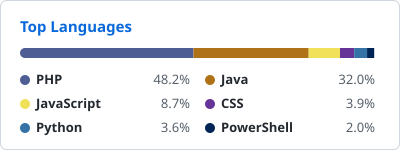

# Hi there! 👋

## 🎧 Recently played on Spotify

<!-- SPOTIFY:START -->
| | Track | Artist | Played |
|---|---|---|---|
|  | [Forever](https://open.spotify.com/track/3NZJlJemX3mzjf56MqC5ML) | Chris Brown | 26 Nov, 21:21 |
|  | [Fallin' For You](https://open.spotify.com/track/1le5KVGTF1xWf2aUj7ruLy) | Colbie Caillat | 26 Nov, 21:16 |
|  | [All Too Well (Taylor's Version)](https://open.spotify.com/track/3nsfB1vus2qaloUdcBZvDu) | Taylor Swift | 26 Nov, 21:13 |
|  | [All Too Well (Taylor's Version)](https://open.spotify.com/track/3nsfB1vus2qaloUdcBZvDu) | Taylor Swift | 26 Nov, 19:47 |
|  | [Al Nuraa....Yang 5....Yang 6 (feat. Daly Filsuf)](https://open.spotify.com/track/1uneiN835tPWp2STYagid9) | Mawi, Hazama, Daly Filsuf | 26 Nov, 19:45 |

Last updated: 28 Nov 2026, 16:56 MYT
<!-- SPOTIFY:END -->

## 📊 GitHub Stats

  
  

## 🐍 Contributions

<picture>
  <source media="(prefers-color-scheme: dark)" srcset="https://raw.githubusercontent.com/fazrilamin/myself/output/github-snake-dark.svg">
  <source media="(prefers-color-scheme: light)" srcset="https://raw.githubusercontent.com/fazrilamin/myself/output/github-snake.svg">
  
</picture>
